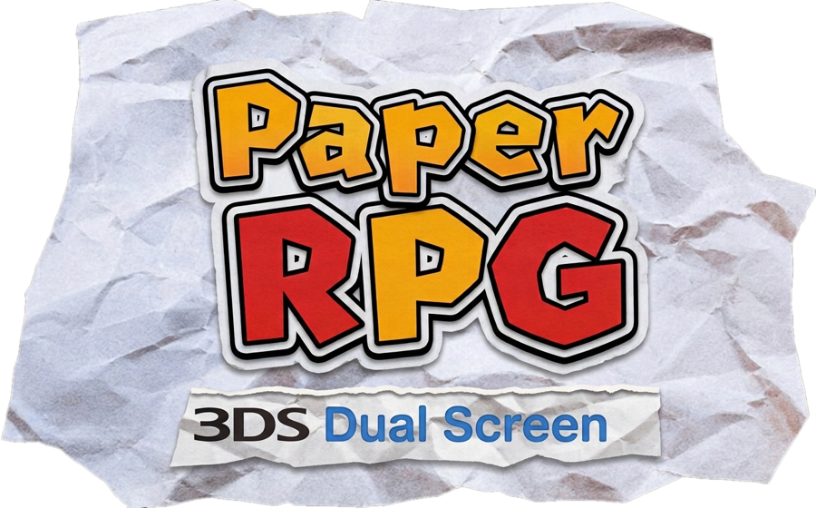

# PaperRPG Dual Screen

**ES** · Port nativo para Nintendo 3DS basado en la decompilación de Paper Mario 64. Sin emulación: el juego corre directo en la consola, con las dos pantallas.
**EN** · A native Nintendo 3DS port built from the Paper Mario 64 decompilation. No emulation: the game runs directly on the console, on both screens.

🌐 **https://chrzazueta.github.io/PaperRPG-3DS/**

> [!IMPORTANT]
> Necesitas **tu propia copia** del juego (Paper Mario, N64, versión USA o europea). Aquí no se distribuye ninguna ROM ni contenido de Nintendo.
> You need **your own copy** of the game (Paper Mario, N64, USA or European version). No ROMs or Nintendo content are distributed here.

## Características / Features

- 30 fps estables en Old 3DS · stable 30 fps on Old 3DS
- Pantalla táctil: medallas, objetos, mapa, espíritus, estadísticas y cambio rápido de compañero · touch screen with badges, items, map, spirits, stats and quick partner swap
- Rueda de comandos, selección de objetivo y comandos de acción táctiles · touch command wheel, target selection and action commands
- Una sola versión para la ROM USA y la europea (PAL, 4 idiomas) · one version for the USA and European (PAL, 4 languages) ROMs
- Avisa y se actualiza con un toque (con Wi-Fi) · notifies and updates with one tap (with Wi-Fi)
- 3 save states con miniatura y fecha · 3 save states with thumbnail and date
- Mod menu (monedas infinitas, modo dios, stats al máximo, carrera rápida, OHKO…) · mod menu
- 3D estereoscópico opcional, modo oscuro, filtro, Skip/Auto en cinemáticas, menús en español/inglés · optional stereoscopic 3D, dark mode, filter, cutscene Skip/Auto, Spanish/English menus

## Instalación / Installation

1. Consola con Luma3DS ([3ds.hacks.guide](https://3ds.hacks.guide/)) · console with Luma3DS.
2. Haz el dump de tu cartucho (USA o europeo) en `.z64`, `.n64` o `.v64` · dump your cartridge (USA or European).
   SHA-1 (`.z64`) USA: `3837f44cda784b466c9a2d99df70d77c322b97a0` · PAL: `2111d39265a317414d359e35a7d971c4dfa5f9e1`
3. Cópialo a / copy it to `sdmc:/3ds/PaperRPG/` con cualquier nombre que contenga "paper" · with any name containing "paper" (e.g. `Paper Mario (USA).z64`).
4. Instala `PaperRPG.cia` con FBI (recomendado) o copia `PaperRPG.3dsx` a `sdmc:/3ds/` · install `PaperRPG.cia` with FBI (recommended) or use `PaperRPG.3dsx` with the Homebrew Launcher.
   Si tenías `PaperRPG_English` o `PaperRPG_Espanol`, desinstálalo; tu partida se conserva · if you had `PaperRPG_English` or `PaperRPG_Espanol`, uninstall it; your save is kept.

Descargas en / downloads in [Releases](https://github.com/ChrZazueta/PaperRPG-3DS/releases/latest).

## Apoyo / Support

El port es gratis. Si quieres invitarme un café · The port is free. If you'd like to buy me a coffee:

## Aviso legal / Legal

PaperRPG Dual Screen es un proyecto de fans sin fines de lucro, sin relación con Nintendo ni Intelligent Systems. Paper Mario y Nintendo 3DS son marcas de sus respectivos dueños. El port no contiene gráficos, música ni textos del juego: los lee de la ROM del usuario al arrancar.

PaperRPG Dual Screen is a non-profit fan project, not affiliated with Nintendo or Intelligent Systems. Paper Mario and Nintendo 3DS are trademarks of their respective owners. The port contains no graphics, music or text from the game: it reads them from the user's ROM at startup.

## Créditos / Credits

- Decompilación de Paper Mario: [pmret/papermario](https://github.com/pmret/papermario)
- [devkitPro](https://devkitpro.org), libctru, citro3d
- Port: [ChrZazueta](https://github.com/ChrZazueta)
